<p align="center">
  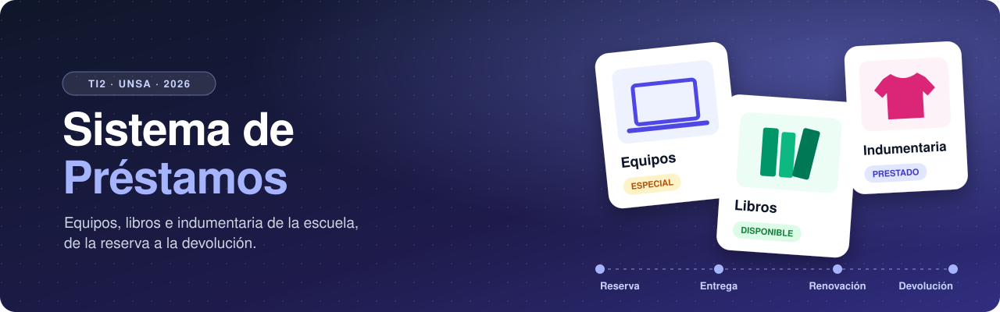
</p>

<p align="center">
  
  
  
  
  
</p>

<p align="center">
  <a href="#-el-sistema-en-pantallas"><b>Pantallas</b></a> &nbsp;·&nbsp;
  <a href="#-qué-hace"><b>Funciones</b></a> &nbsp;·&nbsp;
  <a href="#-cómo-está-construido"><b>Arquitectura</b></a> &nbsp;·&nbsp;
  <a href="#-ponerlo-en-marcha"><b>Instalación</b></a> &nbsp;·&nbsp;
  <a href="#-equipo"><b>Equipo</b></a>
</p>

<br>

La escuela presta **equipos, libros e indumentaria** a alumnos, docentes y personal administrativo. Antes todo se anotaba a mano; este sistema lo lleva de punta a punta: quién pide qué, cuándo lo recoge, si lo devolvió a tiempo y en qué estado.

<table>
  <tr>
    <td align="center" width="25%"><b>4 roles</b><br>con permisos propios</td>
    <td align="center" width="25%"><b>10 módulos</b><br>de negocio</td>
    <td align="center" width="25%"><b>9 estados</b><br>por reserva</td>
    <td align="center" width="25%"><b>5 reportes</b><br>en Excel y PDF</td>
  </tr>
</table>

<br>

## 🖥 El sistema en pantallas

<p align="center">
  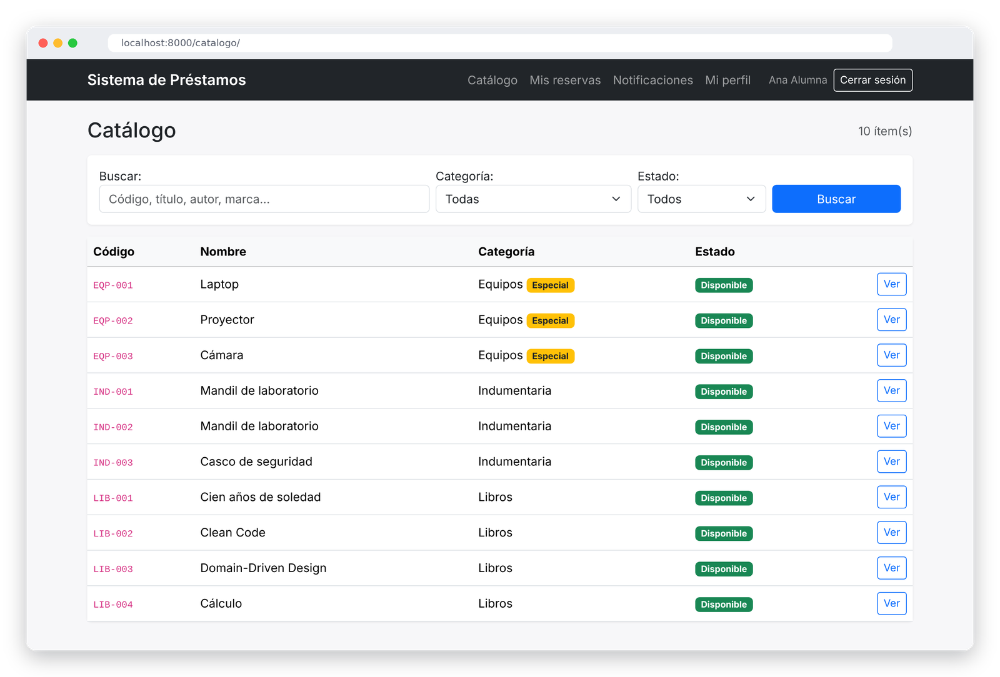
  <br><sub><b>Catálogo</b> · búsqueda por texto, categoría y estado</sub>
</p>

<table>
  <tr>
    <td width="50%" valign="top">
      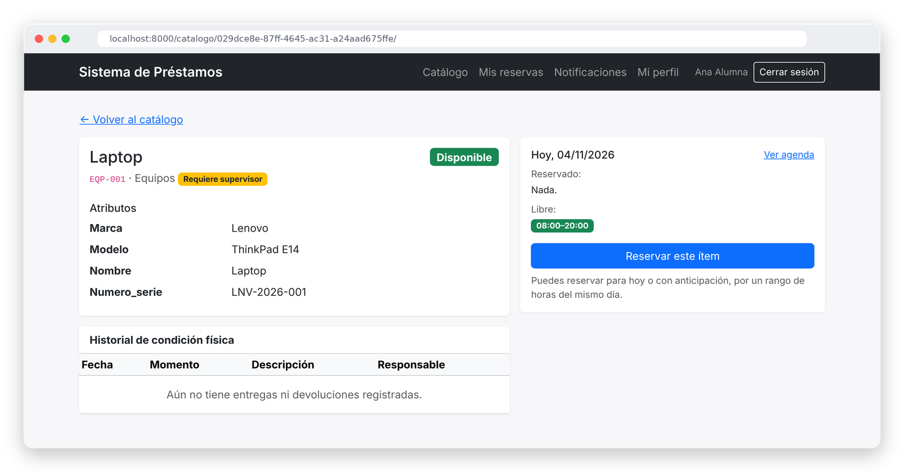
      <p align="center"><sub><b>Detalle del ítem</b> · atributos, agenda del día e historial</sub></p>
    </td>
    <td width="50%" valign="top">
      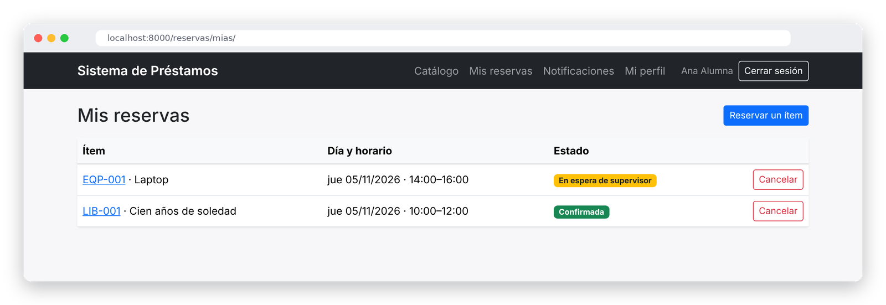
      <p align="center"><sub><b>Mis reservas</b> · cada reserva con su estado actual</sub></p>
      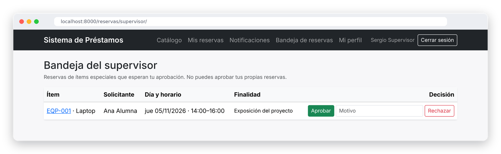
      <p align="center"><sub><b>Bandeja del supervisor</b> · aprobar o rechazar ítems especiales</sub></p>
    </td>
  </tr>
  <tr>
    <td width="50%" valign="top">
      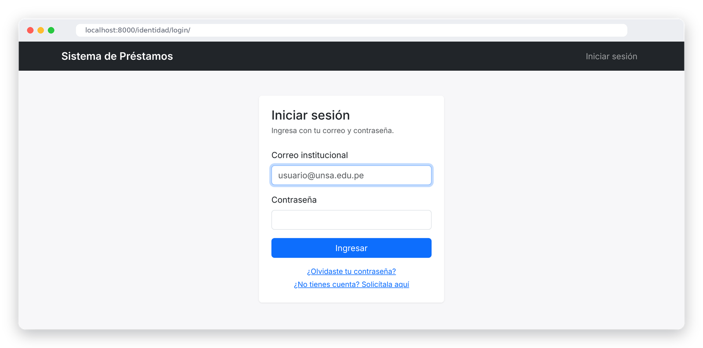
      <p align="center"><sub><b>Inicio de sesión</b> · solo correos institucionales <code>@unsa.edu.pe</code></sub></p>
    </td>
    <td width="50%" valign="top">
      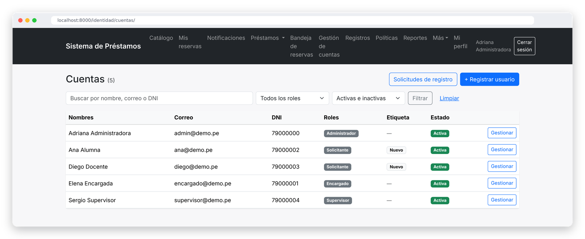
      <p align="center"><sub><b>Gestión de cuentas</b> · roles, etiquetas y solicitudes de registro</sub></p>
    </td>
  </tr>
</table>

<details>
<summary><b>Ver más pantallas</b></summary>
<br>
<table>
  <tr>
    <td width="50%" valign="top">
      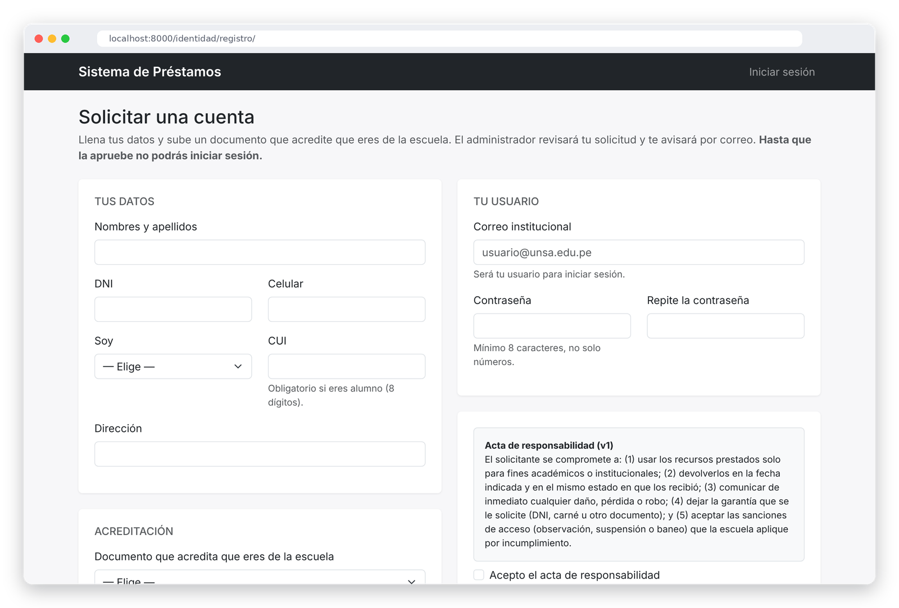
      <p align="center"><sub><b>Solicitar una cuenta</b> · datos, documento y acta</sub></p>
    </td>
    <td width="50%" valign="top">
      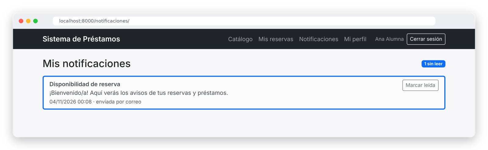
      <p align="center"><sub><b>Mis notificaciones</b> · avisos de reservas y préstamos</sub></p>
    </td>
  </tr>
</table>
</details>

<br>

## ✦ Qué hace

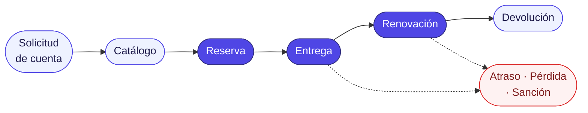

| | Módulo | Lo principal |
|:-:|:--|:--|
| 👤 | **Identidad** | Registro con correo `@unsa.edu.pe`, aprobación del administrador, roles, perfil y recuperación de contraseña. Etiquetas automáticas: nuevo, frecuente, sancionado, baneado |
| 🗂 | **Catálogo** | Ítems con atributos distintos según su categoría (guardados en JSONB), estados y su historial de condición física |
| 📅 | **Reservas** | Agenda por día, franjas de 15 min, lista de espera en orden de llegada, aprobación del supervisor para ítems especiales y expiración si no se recoge |
| 🔄 | **Circulación** | Entregas, renovaciones, devoluciones y préstamos vencidos |
| 📏 | **Políticas** | Duración, antelación, límites y renovaciones, distintos por categoría y tipo de usuario |
| ⚖ | **Sanciones** | Observación, suspensión temporal o baneo, y revisión automática de vencimientos |
| ❗ | **Pérdidas** | Registro y seguimiento de ítems perdidos o robados |
| 🔔 | **Notificaciones** | Recordatorios de vencimiento, atrasos y disponibilidad de reservas |
| 📊 | **Reportes** | Ítems más prestados, usuarios más activos, devoluciones a tiempo, pérdidas y sanciones, en Excel o PDF |
| 🧾 | **Auditoría** | Bitácora de quién hizo qué y cuándo |

### Quién usa el sistema

<table>
  <tr>
    <td align="center" width="25%"><b>Administrador</b><br>Cuentas, aprobaciones, políticas, ítems y reportes</td>
    <td align="center" width="25%"><b>Encargado</b><br>Entregas, devoluciones, pérdidas y sanciones</td>
    <td align="center" width="25%"><b>Supervisor</b><br>Aprueba las reservas de ítems especiales</td>
    <td align="center" width="25%"><b>Solicitante</b><br>Busca, reserva, renueva y revisa sus avisos</td>
  </tr>
</table>

<br>

## ◆ Cómo está construido

Seguimos **Domain-Driven Design**: cada parte del negocio (*Bounded Context*) es una app de Django con sus propias reglas, y se comunica con las demás a través de servicios.

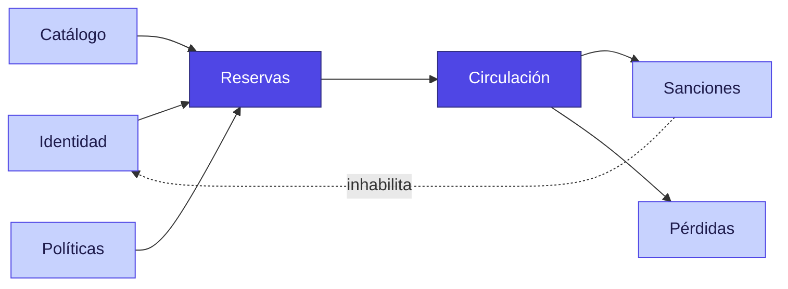

> **Cómo leerlo:** una flecha A → B significa que B usa información o servicios de A. En morado está el **núcleo** del negocio.
> **Notificaciones**, **Auditoría** y **Reportes** son módulos de apoyo que los demás usan para avisar, dejar registro y medir.

Dentro de cada módulo, el código se ordena en **cuatro capas**. La regla de oro: el dominio no depende de nadie.

<table>
  <tr>
    <td align="center" width="25%">🖥 <b>Presentación</b><br><code>presentacion/</code><br>vistas, formularios y plantillas</td>
    <td align="center" width="25%">⚙ <b>Aplicación</b><br><code>aplicacion/</code><br>casos de uso y DTOs</td>
    <td align="center" width="25%">💎 <b>Dominio</b><br><code>dominio/</code><br>reglas del negocio y contratos</td>
    <td align="center" width="25%">🔌 <b>Infraestructura</b><br><code>infraestructura/</code><br>ORM, correo, Excel y PDF</td>
  </tr>
</table>

<details>
<summary><b>Ciclo de vida de una reserva</b></summary>
<br>

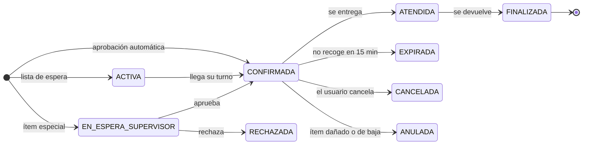

</details>

<details>
<summary><b>Modelo de datos</b></summary>
<br>
<p align="center">
  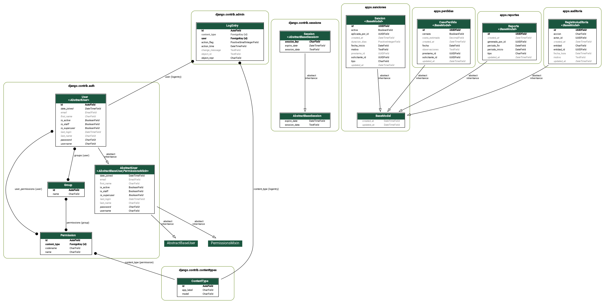
  <br><sub>Base de datos <code>prestamos</code> · tablas <code>&lt;app&gt;_&lt;modelo&gt;</code>, por ejemplo <code>catalogo_item</code> o <code>identidad_cuenta</code></sub>
</p>
</details>

<details>
<summary><b>Reglas principales</b></summary>
<br>

**Horario (igual para todos):** lunes a viernes, de 08:00 a 20:00, en bloques de 15 minutos. Se reserva con al menos 30 minutos de anticipación, entre dos reservas del mismo ítem quedan 15 minutos de margen y hay 15 minutos de tolerancia para recogerlo.

**Políticas (cambian por categoría y tipo de usuario):**

| Política | Valor actual |
|:--|:--|
| Duración máxima | Equipos 3 h · Libros 4 h · Indumentaria 5 h |
| Antelación para reservar | 3 o 7 días |
| Reservas vigentes a la vez | 4 en total · 1 de equipos |
| Renovaciones | 1 o 2 |

**La base de datos también protege:** código de ítem único, un solo préstamo abierto por ítem, fin posterior al inicio, correo y DNI únicos, y no se puede borrar una categoría con ítems.

📄 Todo el detalle, con archivo y línea de cada regla, está en [`docs/reglas_del_sistema.md`](docs/reglas_del_sistema.md).

</details>

<br>

## ▶ Ponerlo en marcha

> **Necesitas:** Python 3.12 o superior, PostgreSQL y Git.

```bash
# 1. Clonar
git clone https://github.com/mikaelf5/Proyecto-Interdisciplinar-II.git
cd Proyecto-Interdisciplinar-II

# 2. Entorno virtual
python -m venv venv
source venv/bin/activate          # En Windows: venv\Scripts\activate

# 3. Dependencias
pip install -r requirements.txt

# 4. Variables de entorno (luego pon tu contraseña de PostgreSQL en .env)
cp .env.example .env
```

Crea la base de datos `prestamos` en pgAdmin (o con `CREATE DATABASE prestamos;`) y continúa:

```bash
# 5. Tablas y datos de demostración
python manage.py migrate
python manage.py seed_demo

# 6. ¡Listo!
python manage.py runserver
```

Abre **http://127.0.0.1:8000** e ingresa con una de estas cuentas (contraseña **`demo1234`**):

| Rol | Correo | Para probar |
|:--|:--|:--|
| Administrador | `admin@demo.pe` | Cuentas, políticas, reportes y `/admin/` |
| Encargado | `encargado@demo.pe` | Entregas y devoluciones |
| Supervisor | `supervisor@demo.pe` | Bandeja de aprobación |
| Solicitante | `ana@demo.pe` | Catálogo y reservas (alumna) |
| Solicitante | `diego@demo.pe` | Catálogo y reservas (docente) |
| Solicitante | `pedro@demo.pe` | Cuenta aún sin validar |

> [!NOTE]
> En desarrollo los correos no se envían: aparecen en la consola donde corre `runserver`.

<details>
<summary><b>Otros comandos útiles</b></summary>
<br>

| Comando | Qué hace |
|:--|:--|
| `python manage.py seed_catalogo --limpiar` | Vuelve a cargar solo el catálogo de ejemplo |
| `python manage.py seed_cuentas` | Restablece las cuentas de demostración |
| `python manage.py expirar_reservas` | Expira reservas no recogidas y avanza la lista de espera |
| `python manage.py revisar_vencimientos` | Avisa préstamos por vencer y marca los vencidos |
| `python manage.py actualizar_etiquetas` | Recalcula las etiquetas de los solicitantes |
| `python manage.py test apps` | Corre todas las pruebas |
| `python manage.py test apps.reservas` | Corre las pruebas de un solo módulo |

</details>

<details>
<summary><b>Estructura de carpetas</b></summary>
<br>

```
Proyecto-Interdisciplinar-II/
├── apps/
│   ├── common/            base compartida, enumeraciones y plantilla general
│   ├── identidad/         cuentas, roles, registro y acceso
│   ├── catalogo/          categorías, ítems y condición física
│   ├── politicas/         reglas configurables de préstamo
│   ├── reservas/          agenda, lista de espera y aprobaciones
│   ├── circulacion/       entregas, renovaciones y devoluciones
│   ├── sanciones/         sanciones y vencimientos
│   ├── perdidas/          casos de pérdida
│   ├── notificaciones/    avisos al usuario
│   ├── reportes/          reportes y exportación
│   └── auditoria/         bitácora de acciones
│
│   cada módulo:  dominio/ · aplicacion/ · infraestructura/ · presentacion/
│                 templates/ · tests/ · fabrica.py
│
├── config/                settings y urls
├── docs/                  documentación, diagramas y capturas
├── .env.example
├── manage.py
└── requirements.txt
```

</details>

<br>

## 📚 Documentación

| | |
|:--|:--|
| [**Reglas del sistema**](docs/reglas_del_sistema.md) | Dónde vive cada regla: políticas, dominio y base de datos |
| [**Mapa frontend → backend**](docs/mapa_frontend_backend.md) | Qué código se ejecuta al presionar cada botón |
| [**Diagrama entidad-relación**](docs/er_diagram.png) | Tablas y relaciones de la base de datos |

<br>

## 👥 Equipo

<table align="center">
  <tr>
    <td align="center" width="200">
      <br><br>
      <b>Micaela</b><br>Uribe Zuñiga
    </td>
    <td align="center" width="200">
      <br><br>
      <b>Natalie Marleny</b><br>Lazo Paxi
    </td>
    <td align="center" width="200">
      <br><br>
      <b>Marving Alonzo</b><br>Zamata Huaracha
    </td>
    <td align="center" width="200">
      <br><br>
      <b>Estrella de Jesús</b><br>Huarsaya Márquez
    </td>
  </tr>
</table>

<p align="center">
  <sub>Trabajo Interdisciplinar 2 · Ciencia de la Computación · Universidad Nacional de San Agustín de Arequipa</sub>
</p>
