<p align="center">
  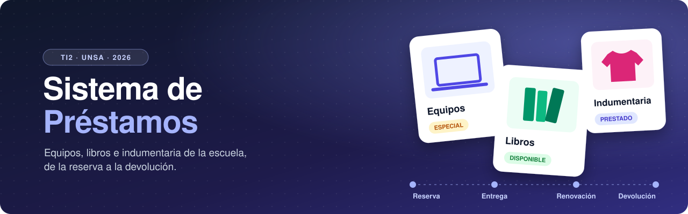
</p>

<p align="center">
  
  
  
  
  
</p>

<p align="center">
  <a href="#-el-sistema-en-pantallas"><b>Pantallas</b></a> &nbsp;·&nbsp;
  <a href="#-qué-hace"><b>Funciones</b></a> &nbsp;·&nbsp;
  <a href="#-cómo-está-construido"><b>Arquitectura</b></a> &nbsp;·&nbsp;
  <a href="#-ponerlo-en-marcha"><b>Instalación</b></a> &nbsp;·&nbsp;
  <a href="#-equipo"><b>Equipo</b></a>
</p>

<br>

La escuela presta **equipos, libros e indumentaria** a alumnos, docentes y personal administrativo. Antes todo se anotaba a mano; este sistema lo lleva de punta a punta: quién pide qué, cuándo lo recoge, si lo devolvió a tiempo y en qué estado.

<table>
  <tr>
    <td align="center" width="25%"><b>4 roles</b><br>con permisos propios</td>
    <td align="center" width="25%"><b>10 módulos</b><br>de negocio</td>
    <td align="center" width="25%"><b>9 estados</b><br>por reserva</td>
    <td align="center" width="25%"><b>5 reportes</b><br>en Excel y PDF</td>
  </tr>
</table>

<br>

## 🖥 El sistema en pantallas

<p align="center">
  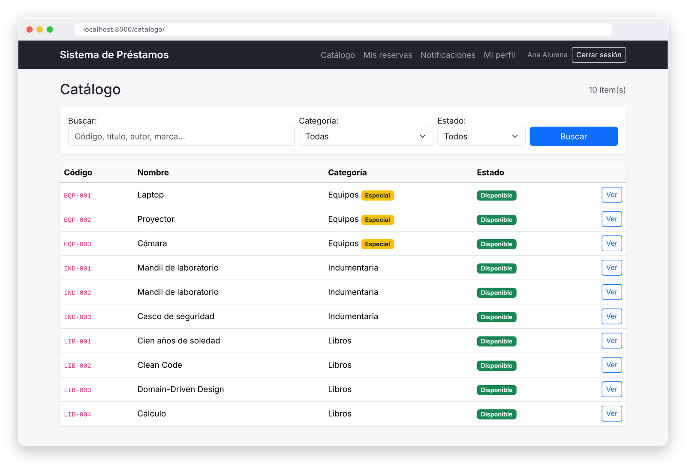
  <br><sub><b>Catálogo</b> · búsqueda por texto, categoría y estado</sub>
</p>

<table>
  <tr>
    <td width="50%" valign="top">
      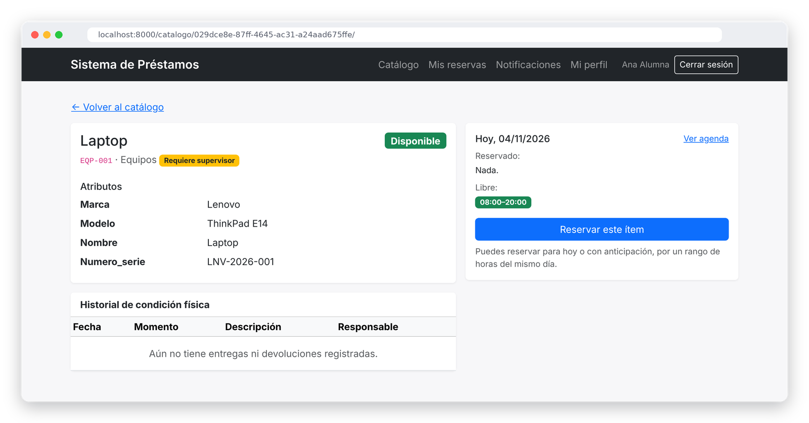
      <p align="center"><sub><b>Detalle del ítem</b> · atributos, agenda del día e historial</sub></p>
    </td>
    <td width="50%" valign="top">
      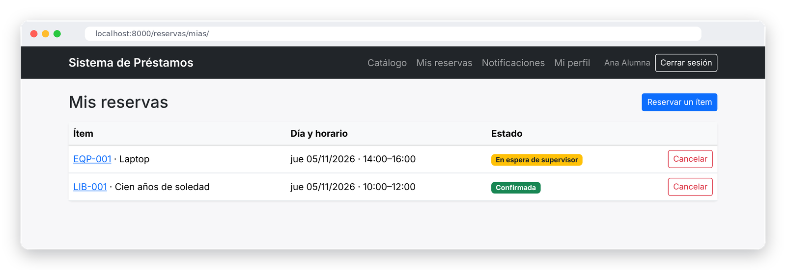
      <p align="center"><sub><b>Mis reservas</b> · cada reserva con su estado actual</sub></p>
      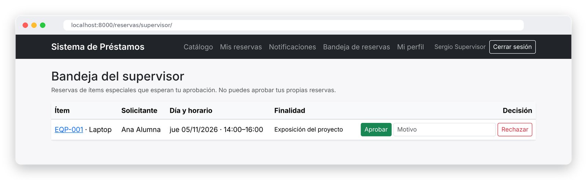
      <p align="center"><sub><b>Bandeja del supervisor</b> · aprobar o rechazar ítems especiales</sub></p>
    </td>
  </tr>
  <tr>
    <td width="50%" valign="top">
      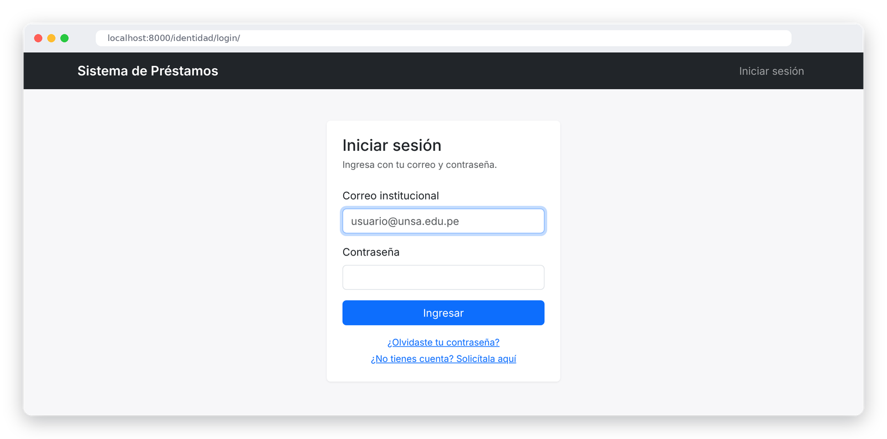
      <p align="center"><sub><b>Inicio de sesión</b> · solo correos institucionales <code>@unsa.edu.pe</code></sub></p>
    </td>
    <td width="50%" valign="top">
      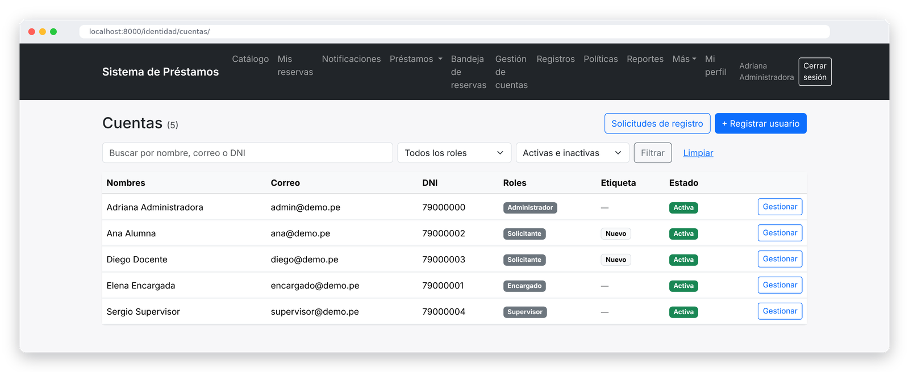
      <p align="center"><sub><b>Gestión de cuentas</b> · roles, etiquetas y solicitudes de registro</sub></p>
    </td>
  </tr>
</table>

<details>
<summary><b>Ver más pantallas</b></summary>
<br>
<table>
  <tr>
    <td width="50%" valign="top">
      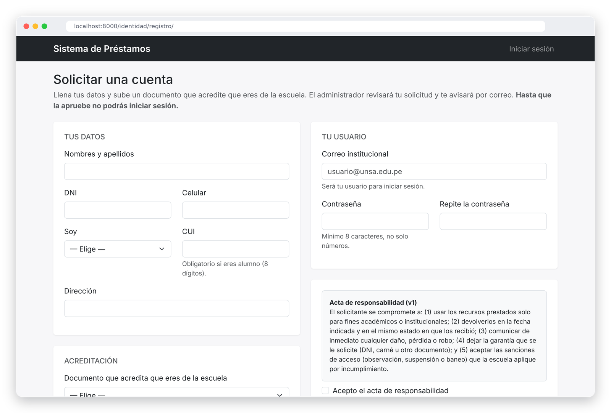
      <p align="center"><sub><b>Solicitar una cuenta</b> · datos, documento y acta</sub></p>
    </td>
    <td width="50%" valign="top">
      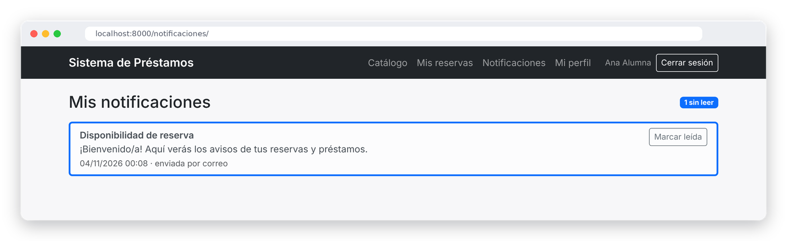
      <p align="center"><sub><b>Mis notificaciones</b> · avisos de reservas y préstamos</sub></p>
    </td>
  </tr>
</table>
</details>

<br>

## ✦ Qué hace

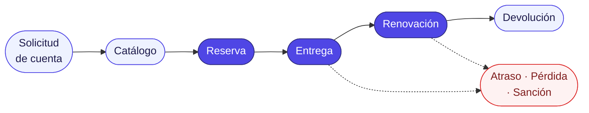

| | Módulo | Lo principal |
|:-:|:--|:--|
| 👤 | **Identidad** | Registro con correo `@unsa.edu.pe`, aprobación del administrador, roles, perfil y recuperación de contraseña. Etiquetas automáticas: nuevo, frecuente, sancionado, baneado |
| 🗂 | **Catálogo** | Ítems con atributos distintos según su categoría (guardados en JSONB), estados y su historial de condición física |
| 📅 | **Reservas** | Agenda por día, franjas de 15 min, lista de espera en orden de llegada, aprobación del supervisor para ítems especiales y expiración si no se recoge |
| 🔄 | **Circulación** | Entregas, renovaciones, devoluciones y préstamos vencidos |
| 📏 | **Políticas** | Duración, antelación, límites y renovaciones, distintos por categoría y tipo de usuario |
| ⚖ | **Sanciones** | Observación, suspensión temporal o baneo, y revisión automática de vencimientos |
| ❗ | **Pérdidas** | Registro y seguimiento de ítems perdidos o robados |
| 🔔 | **Notificaciones** | Recordatorios de vencimiento, atrasos y disponibilidad de reservas |
| 📊 | **Reportes** | Ítems más prestados, usuarios más activos, devoluciones a tiempo, pérdidas y sanciones, en Excel o PDF |
| 🧾 | **Auditoría** | Bitácora de quién hizo qué y cuándo |

### Quién usa el sistema

<table>
  <tr>
    <td align="center" width="25%"><b>Administrador</b><br>Cuentas, aprobaciones, políticas, ítems y reportes</td>
    <td align="center" width="25%"><b>Encargado</b><br>Entregas, devoluciones, pérdidas y sanciones</td>
    <td align="center" width="25%"><b>Supervisor</b><br>Aprueba las reservas de ítems especiales</td>
    <td align="center" width="25%"><b>Solicitante</b><br>Busca, reserva, renueva y revisa sus avisos</td>
  </tr>
</table>

<br>

## ◆ Cómo está construido

Seguimos **Domain-Driven Design**: cada parte del negocio (*Bounded Context*) es una app de Django con sus propias reglas, y se comunica con las demás a través de servicios.

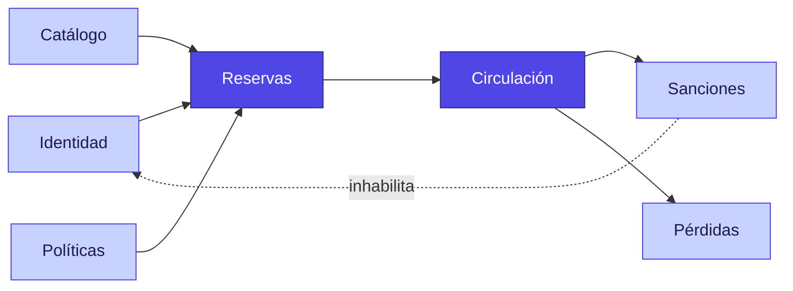

> **Cómo leerlo:** una flecha A → B significa que B usa información o servicios de A. En morado está el **núcleo** del negocio.
> **Notificaciones**, **Auditoría** y **Reportes** son módulos de apoyo que los demás usan para avisar, dejar registro y medir.

Dentro de cada módulo, el código se ordena en **cuatro capas**. La regla de oro: el dominio no depende de nadie.

<table>
  <tr>
    <td align="center" width="25%">🖥 <b>Presentación</b><br><code>presentacion/</code><br>vistas, formularios y plantillas</td>
    <td align="center" width="25%">⚙ <b>Aplicación</b><br><code>aplicacion/</code><br>casos de uso y DTOs</td>
    <td align="center" width="25%">💎 <b>Dominio</b><br><code>dominio/</code><br>reglas del negocio y contratos</td>
    <td align="center" width="25%">🔌 <b>Infraestructura</b><br><code>infraestructura/</code><br>ORM, correo, Excel y PDF</td>
  </tr>
</table>

<details>
<summary><b>Ciclo de vida de una reserva</b></summary>
<br>

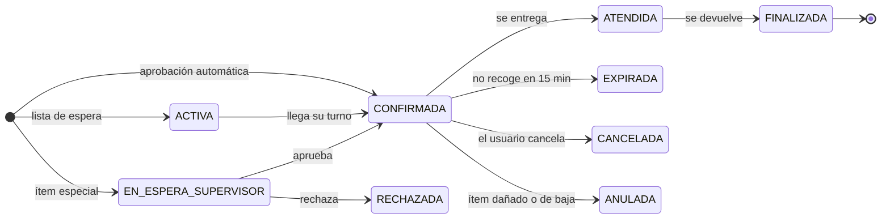

</details>

<details>
<summary><b>Modelo de datos</b></summary>
<br>
<p align="center">
  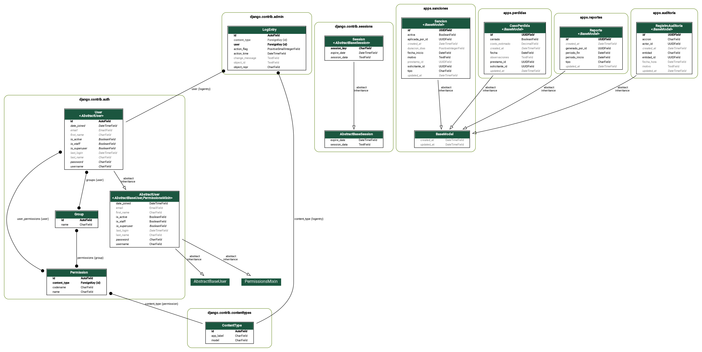
  <br><sub>Base de datos <code>prestamos</code> · tablas <code>&lt;app&gt;_&lt;modelo&gt;</code>, por ejemplo <code>catalogo_item</code> o <code>identidad_cuenta</code></sub>
</p>
</details>

<details>
<summary><b>Reglas principales</b></summary>
<br>

**Horario (igual para todos):** lunes a viernes, de 08:00 a 20:00 (se puede elegir cualquier minuto). Se reserva con al menos 30 minutos de anticipación, entre dos reservas del mismo ítem quedan 15 minutos de margen y hay 15 minutos de tolerancia para recogerlo.

**Políticas (cambian por categoría y tipo de usuario):**

| Política | Valor actual |
|:--|:--|
| Duración máxima | Equipos 3 h · Libros 4 h · Indumentaria 5 h |
| Antelación para reservar | 3 o 7 días |
| Reservas vigentes a la vez | 4 en total · 1 de equipos |
| Renovaciones | 1 o 2 |

**La base de datos también protege:** código de ítem único, un solo préstamo abierto por ítem, fin posterior al inicio, correo y DNI únicos, y no se puede borrar una categoría con ítems.

📄 Todo el detalle, con archivo y línea de cada regla, está en [`docs/reglas_del_sistema.md`](docs/reglas_del_sistema.md).

</details>

<br>

## ▶ Ponerlo en marcha

> **Necesitas:** Python 3.12 o superior, PostgreSQL y Git.

```bash
# 1. Clonar
git clone https://github.com/mikaelf5/Proyecto-Interdisciplinar-II.git
cd Proyecto-Interdisciplinar-II

# 2. Entorno virtual
python -m venv venv
source venv/bin/activate          # En Windows: venv\Scripts\activate

# 3. Dependencias
pip install -r requirements.txt

# 4. Variables de entorno (luego pon tu contraseña de PostgreSQL en .env)
cp .env.example .env
```

Crea la base de datos `prestamos` en pgAdmin (o con `CREATE DATABASE prestamos;`) y continúa:

```bash
# 5. Tablas y datos de demostración
python manage.py migrate
python manage.py seed_demo
python manage.py seed_unsa        # usuarios del curso: los mismos datos para todo el equipo

# 6. ¡Listo!
python manage.py runserver
```

Abre **http://127.0.0.1:8000** e ingresa con una de estas cuentas (contraseña **`demo1234`**):

| Rol | Correo | Para probar |
|:--|:--|:--|
| Administrador | `admin@demo.pe` | Cuentas, políticas, reportes y `/admin/` |
| Encargado | `encargado@demo.pe` | Entregas y devoluciones |
| Supervisor | `supervisor@demo.pe` | Bandeja de aprobación |
| Solicitante | `ana@demo.pe` | Catálogo y reservas (alumna) |
| Solicitante | `diego@demo.pe` | Catálogo y reservas (docente) |
| Solicitante | `pedro@demo.pe` | Cuenta aún sin validar |

> [!NOTE]
> En desarrollo los correos no se envían: aparecen en la consola donde corre `runserver`.

### 👥 Datos compartidos del curso (`seed_unsa`)

Para que **todos tengamos los mismos datos** en la base local, el comando `seed_unsa` carga a las personas reales del curso con datos personales **ficticios pero fijos** (están escritos en [`apps/identidad/management/commands/seed_unsa.py`](apps/identidad/management/commands/seed_unsa.py), no se generan al azar).

```bash
python manage.py seed_unsa
```

| | Cantidad | Tipo | Roles |
|:--|:-:|:--|:--|
| Alumnos | 48 | Alumno (con CUI) | Solicitante |
| Docentes | 5 | Docente | Solicitante · la docente del curso también es **Supervisor** |
| Administrativos | 2 | Administrativo | Solicitante + **Administrador** (Raquel Argüelles) o **Encargado** (Juan Carlos Gutiérrez) |

- **Contraseña de todos:** `unsa2026`
- **Correo:** primera letra del primer nombre + apellido paterno + primera letra del apellido materno, en minúsculas, sin tildes ni espacios. Ej.: *Natalie Marleny Lazo Paxi* → `nlazop@unsa.edu.pe`
- **DNI, CUI, celular y dirección son inventados.** Todos los perfiles quedan habilitados y con el acta firmada.
- Se puede correr las veces que quieras: si alguien cambió algo, lo deja otra vez como está en el archivo. No toca las cuentas `@demo.pe`.
- Para agregar o cambiar a alguien, se edita el archivo, se sube al repo y **todos** vuelven a correr `python manage.py seed_unsa`.

<details>
<summary><b>Ver las 55 cuentas</b></summary>
<br>

| # | Nombre | Correo | Tipo | Roles | CUI | DNI |
|:-:|:--|:--|:--|:--|:-:|:-:|
| 1 | Jesus Alberto Alfaro Buiza | `jalfarob@unsa.edu.pe` | Alumno | Solicitante | 20238233 | 71999250 |
| 2 | Marco Antonio Armendariz Paredes | `marmendarizp@unsa.edu.pe` | Alumno | Solicitante | 20236891 | 76213386 |
| 3 | Albert Gussepe Blanco Cana | `ablancoc@unsa.edu.pe` | Alumno | Solicitante | 20220041 | 74700173 |
| 4 | Karina Paola Calcina Chuquipalla | `kcalcinac@unsa.edu.pe` | Alumno | Solicitante | 20217367 | 77851490 |
| 5 | Diego Canqui Ecos | `dcanquie@unsa.edu.pe` | Alumno | Solicitante | 20234120 | 72763492 |
| 6 | Anderson Samuel Carpio Chura | `acarpioc@unsa.edu.pe` | Alumno | Solicitante | 20231250 | 77257649 |
| 7 | Moises Robert Ccaso Idme | `mccasoi@unsa.edu.pe` | Alumno | Solicitante | 20234712 | 75513614 |
| 8 | Elyud Edgar Chayña Calcina | `echaynac@unsa.edu.pe` | Alumno | Solicitante | 20249460 | 76905374 |
| 9 | Luis Antonio Chipana Chura | `lchipanac@unsa.edu.pe` | Alumno | Solicitante | 20237554 | 74094092 |
| 10 | Aldair Daniel Condori Ataucuri | `acondoria@unsa.edu.pe` | Alumno | Solicitante | 20231907 | 75651055 |
| 11 | Emilio Alejandro Condori Pallardel | `econdorip@unsa.edu.pe` | Alumno | Solicitante | 20239240 | 73169658 |
| 12 | Stephano Gian Pierre Delgado Chavez | `sdelgadoc@unsa.edu.pe` | Alumno | Solicitante | 20220800 | 77424216 |
| 13 | Mauricio Alejandro Farfan Huayta | `mfarfanh@unsa.edu.pe` | Alumno | Solicitante | 20232333 | 74602148 |
| 14 | Fernando Antonio Gama Llicahua | `fgamal@unsa.edu.pe` | Alumno | Solicitante | 20247484 | 76256893 |
| 15 | Carlos Enrique Gutierrez Castilla | `cgutierrezc@unsa.edu.pe` | Alumno | Solicitante | 20236587 | 73105594 |
| 16 | Johan Diego Huamani Sabina | `jhuamanis@unsa.edu.pe` | Alumno | Solicitante | 20247846 | 75210239 |
| 17 | Estrella de Jesús Emilia Fabiana Huarsaya Márquez | `ehuarsayam@unsa.edu.pe` | Alumno | Solicitante | 20230151 | 77977996 |
| 18 | Lizzy Arlette Huayhua Perez | `lhuayhuap@unsa.edu.pe` | Alumno | Solicitante | 20238020 | 74843890 |
| 19 | Roid Niro Huaylla Guzman | `rhuayllag@unsa.edu.pe` | Alumno | Solicitante | 20238376 | 75073249 |
| 20 | Daysi Jara Arisaca | `djaraa@unsa.edu.pe` | Alumno | Solicitante | 20214752 | 78610700 |
| 21 | Hellen Grace Juan de Dios Delgado | `hjuandediosd@unsa.edu.pe` | Alumno | Solicitante | 20248440 | 74677993 |
| 22 | Natalie Marleny Lazo Paxi | `nlazop@unsa.edu.pe` | Alumno | Solicitante | 20247850 | 78066897 |
| 23 | Fernando Enrique Llosa Manchego | `fllosam@unsa.edu.pe` | Alumno | Solicitante | 20226738 | 71810864 |
| 24 | Mariana Valery Luis Jimenez | `mluisj@unsa.edu.pe` | Alumno | Solicitante | 20239513 | 71001794 |
| 25 | Diego de Alessandro Mamani Salazar | `dmamanis@unsa.edu.pe` | Alumno | Solicitante | 20210731 | 73079012 |
| 26 | Luis Fernando Morales Tacca | `lmoralest@unsa.edu.pe` | Alumno | Solicitante | 20220084 | 73996835 |
| 27 | Neill Elverth Olazabal Chavez | `nolazabalc@unsa.edu.pe` | Alumno | Solicitante | 20228942 | 78864433 |
| 28 | Alvaro Johan Panibra Choctaya | `apanibrac@unsa.edu.pe` | Alumno | Solicitante | 20248269 | 76017531 |
| 29 | Javier Alonzo Peñalva Humire | `jpenalvah@unsa.edu.pe` | Alumno | Solicitante | 20229601 | 72343196 |
| 30 | Jesus Gustavo Perez Villasante | `jperezv@unsa.edu.pe` | Alumno | Solicitante | 20226160 | 75362335 |
| 31 | Juan Carlos Postigo Cabana | `jpostigoc@unsa.edu.pe` | Alumno | Solicitante | 20235790 | 71430967 |
| 32 | Claudia Roxana Quisocala Cruz | `cquisocalac@unsa.edu.pe` | Alumno | Solicitante | 20244975 | 73749450 |
| 33 | Sharmely Yesenia Quispe Chavez | `squispec@unsa.edu.pe` | Alumno | Solicitante | 20239365 | 78958961 |
| 34 | David Augusto Quispe Lloccallasi | `dquispel@unsa.edu.pe` | Alumno | Solicitante | 20227104 | 75358835 |
| 35 | Angelo Josue Quispe Suarez | `aquispes@unsa.edu.pe` | Alumno | Solicitante | 20241138 | 72957284 |
| 36 | Job Lorenzo Quispe Torrez | `jquispet@unsa.edu.pe` | Alumno | Solicitante | 20220741 | 76429362 |
| 37 | Luis Enrique Ramos Chambi | `lramosc@unsa.edu.pe` | Alumno | Solicitante | 20230335 | 72581498 |
| 38 | Rodrigo Abraham Ramos Mamani | `rramosm@unsa.edu.pe` | Alumno | Solicitante | 20222627 | 78504580 |
| 39 | Omar Joaquin Rivera Olivera | `oriverao@unsa.edu.pe` | Alumno | Solicitante | 20236784 | 74568130 |
| 40 | Edu Andre Sucari Ccansaya | `esucaric@unsa.edu.pe` | Alumno | Solicitante | 20224316 | 73886234 |
| 41 | Cristhian Luis Taipe Huanca | `ctaipeh@unsa.edu.pe` | Alumno | Solicitante | 20232899 | 73413153 |
| 42 | Lizeth Angelica Tito Vilca | `ltitov@unsa.edu.pe` | Alumno | Solicitante | 20234486 | 75422909 |
| 43 | Jhair Alejandro Torres Chavez | `jtorresc@unsa.edu.pe` | Alumno | Solicitante | 20217440 | 78999996 |
| 44 | Micaela Belen Uribe Zuñiga | `muribez@unsa.edu.pe` | Alumno | Solicitante | 20242989 | 77570912 |
| 45 | Ronald Reynaldo Valdez Agüero | `rvaldeza@unsa.edu.pe` | Alumno | Solicitante | 20239377 | 73950287 |
| 46 | Diego Mauricio Villanueva Flores | `dvillanuevaf@unsa.edu.pe` | Alumno | Solicitante | 20239106 | 77006348 |
| 47 | Marving Alonzo Zamata Huaracha | `mzamatah@unsa.edu.pe` | Alumno | Solicitante | 20239105 | 75721371 |
| 48 | Eduardo Josue Zela Quispe | `ezelaq@unsa.edu.pe` | Alumno | Solicitante | 20232806 | 71808919 |
| 49 | Yessenia Deysi Yari Ramos | `yyarir@unsa.edu.pe` | Docente | Solicitante, Supervisor | — | 29857447 |
| 50 | Ana Maria Cuadros Valdivia | `acuadrosv@unsa.edu.pe` | Docente | Solicitante | — | 29390231 |
| 51 | Edgar Sarmiento Calisaya | `esarmientoc@unsa.edu.pe` | Docente | Solicitante | — | 29269230 |
| 52 | Rolando Jesus Cardenas Talavera | `rcardenast@unsa.edu.pe` | Docente | Solicitante | — | 29531638 |
| 53 | Alfredo Paz Valderrama | `apazv@unsa.edu.pe` | Docente | Solicitante | — | 29201135 |
| 54 | Raquel Consuelo Argüelles Flórez | `rarguellesf@unsa.edu.pe` | Administrativo | Solicitante, Administrador | — | 29198429 |
| 55 | Juan Carlos Gutierrez Caceres | `jgutierrezc@unsa.edu.pe` | Administrativo | Solicitante, Encargado | — | 29736753 |

</details>

<details>
<summary><b>Otros comandos útiles</b></summary>
<br>

| Comando | Qué hace |
|:--|:--|
| `python manage.py seed_catalogo --limpiar` | Vuelve a cargar solo el catálogo de ejemplo |
| `python manage.py seed_cuentas` | Restablece las cuentas de demostración |
| `python manage.py seed_unsa` | Carga o restablece los usuarios del curso (mismos datos para todos) |
| `python manage.py expirar_reservas` | Expira reservas no recogidas y avanza la lista de espera |
| `python manage.py revisar_vencimientos` | Avisa préstamos por vencer y marca los vencidos |
| `python manage.py actualizar_etiquetas` | Recalcula las etiquetas de los solicitantes |
| `python manage.py test apps` | Corre todas las pruebas |
| `python manage.py test apps.reservas` | Corre las pruebas de un solo módulo |

</details>

<details>
<summary><b>Estructura de carpetas</b></summary>
<br>

```
Proyecto-Interdisciplinar-II/
├── apps/
│   ├── common/            base compartida, enumeraciones y plantilla general
│   ├── identidad/         cuentas, roles, registro y acceso
│   ├── catalogo/          categorías, ítems y condición física
│   ├── politicas/         reglas configurables de préstamo
│   ├── reservas/          agenda, lista de espera y aprobaciones
│   ├── circulacion/       entregas, renovaciones y devoluciones
│   ├── sanciones/         sanciones y vencimientos
│   ├── perdidas/          casos de pérdida
│   ├── notificaciones/    avisos al usuario
│   ├── reportes/          reportes y exportación
│   └── auditoria/         bitácora de acciones
│
│   cada módulo:  dominio/ · aplicacion/ · infraestructura/ · presentacion/
│                 templates/ · tests/ · fabrica.py
│
├── config/                settings y urls
├── docs/                  documentación, diagramas y capturas
├── .env.example
├── manage.py
└── requirements.txt
```

</details>

<br>

## 📚 Documentación

| | |
|:--|:--|
| [**Reglas del sistema**](docs/reglas_del_sistema.md) | Dónde vive cada regla: políticas, dominio y base de datos |
| [**Mapa frontend → backend**](docs/mapa_frontend_backend.md) | Qué código se ejecuta al presionar cada botón |
| [**Diagrama entidad-relación**](docs/er_diagram.png) | Tablas y relaciones de la base de datos |

<br>

## 👥 Equipo

<table align="center">
  <tr>
    <td align="center" width="200">
      <br><br>
      <b>Micaela</b><br>Uribe Zuñiga
    </td>
    <td align="center" width="200">
      <br><br>
      <b>Natalie Marleny</b><br>Lazo Paxi
    </td>
    <td align="center" width="200">
      <br><br>
      <b>Marving Alonzo</b><br>Zamata Huaracha
    </td>
    <td align="center" width="200">
      <br><br>
      <b>Estrella de Jesús</b><br>Huarsaya Márquez
    </td>
  </tr>
</table>

<p align="center">
  <sub>Trabajo Interdisciplinar 2 · Ciencia de la Computación · Universidad Nacional de San Agustín de Arequipa</sub>
</p>
